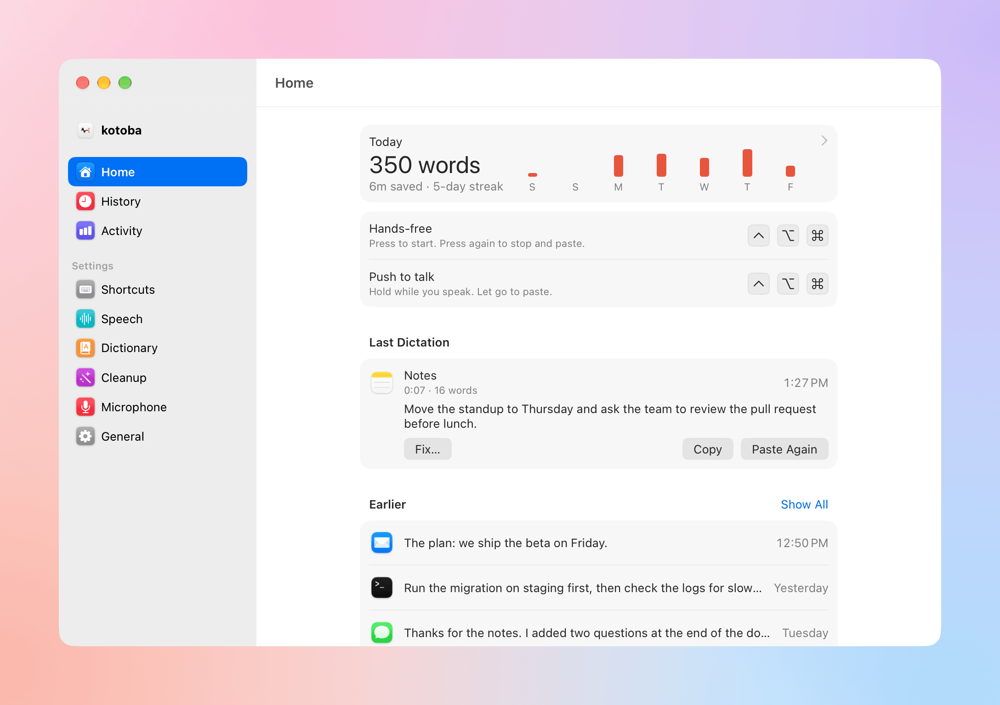
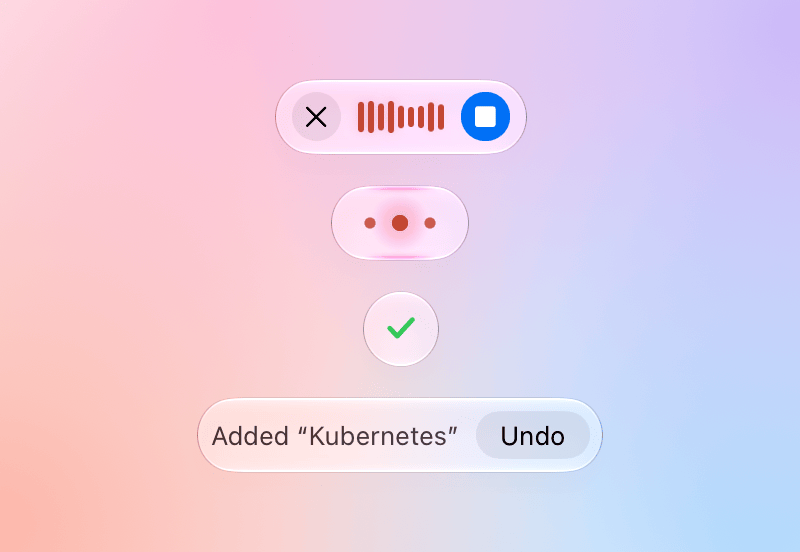
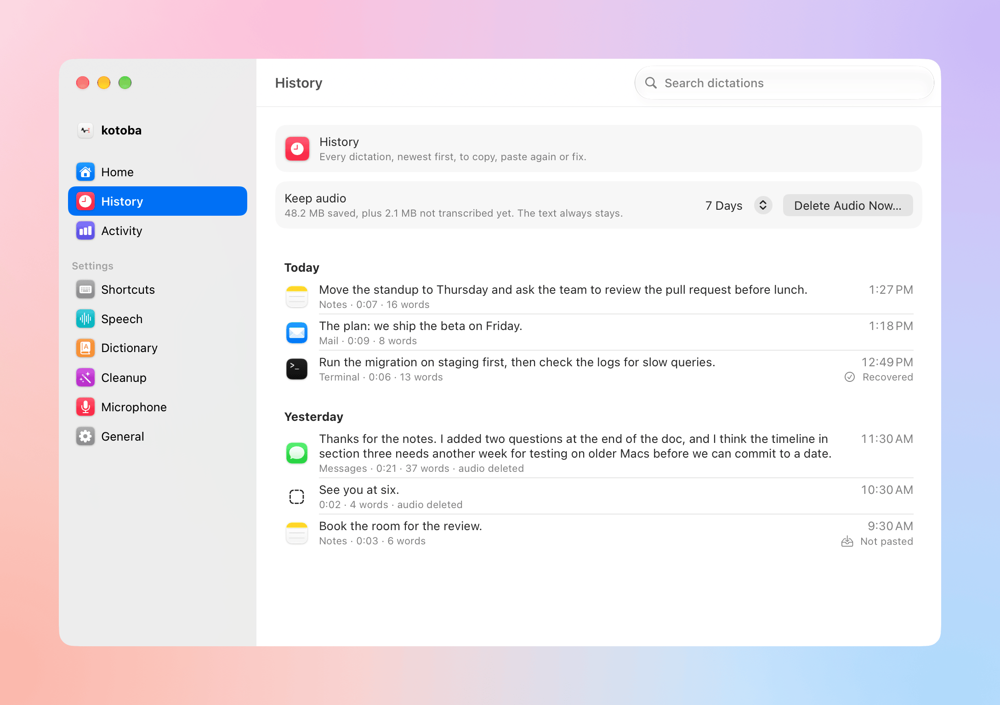
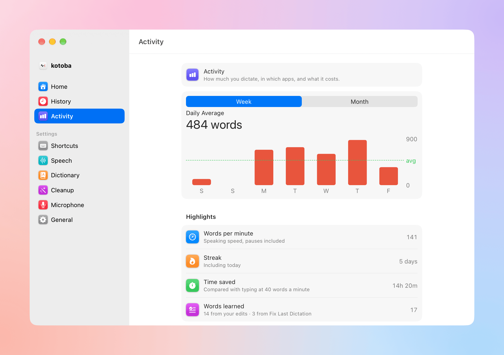
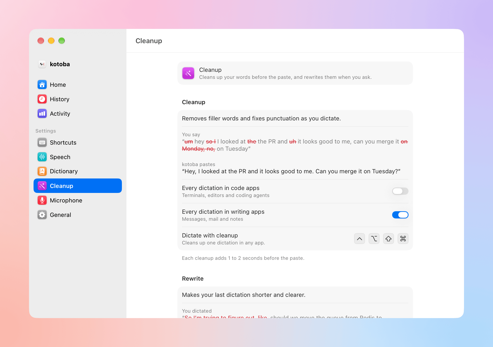
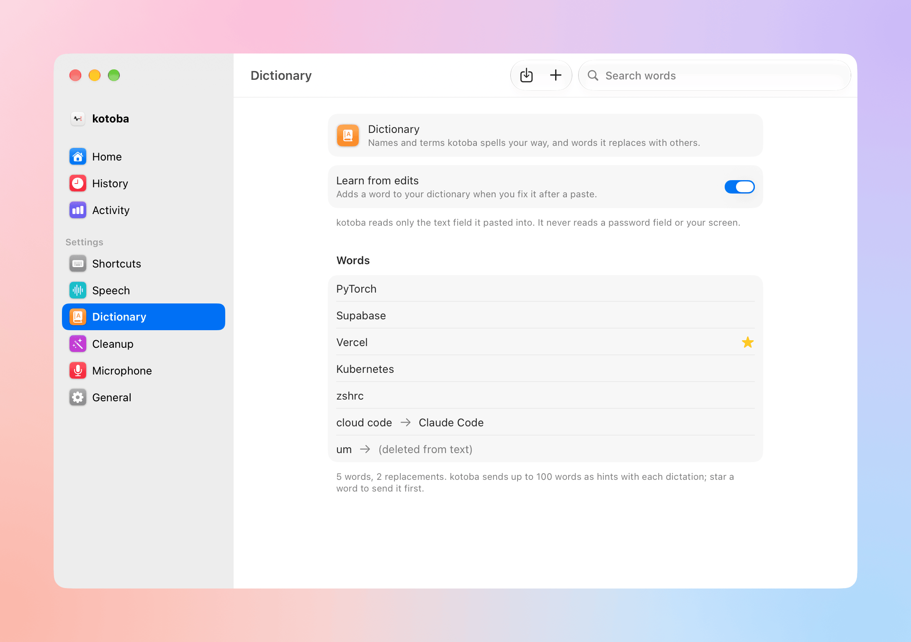

<p align="center">
  <picture>
    <source media="(prefers-color-scheme: dark)" srcset="design/icon/source/app-icon-dark.svg">
    
  </picture>
</p>

<h1 align="center">kotoba</h1>

<p align="center">
  <b>Dictation for Mac that gets your technical words right.</b><br>
  Press a shortcut, speak, press it again. Your words are in your app a second later.
</p>

<p align="center">
  <a href="https://github.com/shiroyasha9/kotoba/releases/latest"><b>Download for macOS</b></a>
  · Free and open source · macOS 26 or later
</p>

<p align="center">
  <picture>
    <source media="(prefers-color-scheme: dark)" srcset="docs/images/showcase-home-dark.png">
    
  </picture>
</p>

<p align="center">
  <picture>
    <source media="(prefers-color-scheme: dark)" srcset="docs/images/showcase-pills-dark.png">
    
  </picture>
</p>

A native, open-source alternative to Wispr Flow, made for people who dictate to coding agents: file names, flags and identifiers, in terminals, editors and browsers.

## Why kotoba

- A second from stop to paste: median 987 ms in daily use.
- 84.6% of technical terms exactly right on 62 real dictations, against 50.0% for Wispr Flow.
- No kotoba account or server, and no analytics. Your audio goes to the speech service you choose, with your own key.
- No subscription: $0.10 per hour of audio, paid to OpenRouter (a promotional price until 2026-12-31).
- 15.9 MB at idle and 75 MB after a day of use. A native Mac app, not a browser in a window.

## kotoba vs Wispr Flow

| | kotoba | Wispr Flow |
|---|---|---|
| Technical terms transcribed exactly | **84.6%** (44 of 52) | 50.0% (26 of 52) |
| Word error rate on real dictations | **3.3%** | 6.0% |
| Memory at idle (after launch, no window opened) | **15.9 MB** | 748 MB (third-party test) |
| Stop press to paste in the app, p50 / p90 | 987 ms / 2,047 ms | not compared |
| Speech round trip, p50 / p90 | 902 ms / 1,083 ms | not compared |
| Price | **$0.10 per hour of audio** | $12-15 per month for Pro |
| Download | 6.5 MB DMG | |

62 real dictations from one developer, mostly coding prompts. Methods, sources and limits: [docs/benchmarks.md](docs/benchmarks.md).

## Features

### Dictate anywhere

- Press ⌃⌥⌘ to start and again to stop, or hold it while you speak. Pick any shortcut, even fn alone or a middle or side mouse button, and give push to talk its own, even ⌥ alone. Press push to talk twice to go hands-free.
- Pastes into the app in front, from terminals and editors to browsers and chat, then puts your clipboard back.
- Esc cancels, with 5 seconds to Undo. Press Return while you speak, or end with "press enter", to paste and send in one step.
- Say "new line" or "new paragraph" for a line break (turn it on in Shortcuts).
- A small pill shows bars while you speak and tells you when the mic hears nothing.
- Your music keeps its quality: while AirPods play it, kotoba records from the built-in mic.
- Lives in the Dock and the menu bar. Hide either one.

### Get technical words right

- Learns your names and technical terms: your dictionary goes to the speech model as hints, and its replacement rules run on every transcript.
- Learns from your edits: fix a word right after a paste, and kotoba adds it. In a terminal, use "Fix Last Dictation…".
- Imports your Wispr Flow dictionary in one click, with the corrections Wispr Flow learned.

### Clean up, per app

- A second shortcut (⌃⌥⇧⌘) removes filler words and fixes punctuation, with DeepSeek V4.1 Flash on Together (the default, about 0.6 s), Gemini 3.5 Flash-Lite, Qwen 3.8 27B on Cerebras or Claude Haiku 5.5.
- In code apps, cleanup keeps commands, paths and flags as you said them; in writing apps, it writes clear sentences in your words. kotoba picks the style from the app in front, and the Cleanup page shows an example of each.
- Rewrite makes your last dictation shorter and clearer, from the menu or its own shortcut, with DeepSeek V4.1 Flash through OpenRouter. "View Changes…" in History shows what cleanup and Rewrite changed.

### Never lose a dictation

- Offline? It finishes when you're back. A failed dictation keeps its audio and retries on its own.
- Locking the screen or putting the Mac to sleep stops the recording and transcribes what you said.
- History keeps every dictation, with search, Copy, Paste Again and Retry. Play its saved audio, or transcribe it again with another speech model.
- Paste or copy your last dictation from the menu or with its own shortcut (Copy Last is ⌃⌘C).

### See what you dictate

- Home: today's words, time saved and your streak, with the last 7 days.
- Activity: words per day for the week or the month, words per minute, your top apps, and this month's spend from the cost OpenRouter reports.

### Speech models

MAI-Transcribe-2 (recommended) or Grok through OpenRouter, with one key. Under Speech > Advanced…, use Grok through xAI or MAI-Transcribe-2 through Azure with your own key.

## Screenshots

<table>
  <tr>
    <td width="50%">
      <picture>
        <source media="(prefers-color-scheme: dark)" srcset="docs/images/showcase-history-dark.png">
        
      </picture>
      <p align="center">History</p>
    </td>
    <td width="50%">
      <picture>
        <source media="(prefers-color-scheme: dark)" srcset="docs/images/showcase-activity-dark.png">
        
      </picture>
      <p align="center">Activity</p>
    </td>
  </tr>
  <tr>
    <td width="50%">
      <picture>
        <source media="(prefers-color-scheme: dark)" srcset="docs/images/showcase-modes-dark.png">
        
      </picture>
      <p align="center">Cleanup</p>
    </td>
    <td width="50%">
      <picture>
        <source media="(prefers-color-scheme: dark)" srcset="docs/images/showcase-dictionary-dark.png">
        
      </picture>
      <p align="center">Dictionary</p>
    </td>
  </tr>
</table>

The screenshots show sample data.

## Install

1. Download the latest `kotoba-<version>.dmg` from [Releases](https://github.com/shiroyasha9/kotoba/releases). It is signed with a Developer ID and notarized by Apple.
2. Drag kotoba to Applications and open it.
3. Setup asks for the microphone and Accessibility (for your shortcut and the paste in every app), then an [OpenRouter](https://openrouter.ai) key, then lets you try a dictation. If Wispr Flow is installed, its last step offers to import your dictionary.

kotoba updates itself with [Sparkle](https://sparkle-project.org).

## Privacy

- Audio goes only to the speech service you choose, with your own key. There is no kotoba server and no account.
- On OpenRouter, kotoba asks for endpoints that keep no data (`provider.zdr`) for MAI-Transcribe-2 and for every cleanup and Rewrite model. Grok has no such endpoint, and kotoba tells you when you pick it.
- API keys stay in the macOS Keychain. Transcripts, audio and your dictionary stay in `~/Library/Application Support/kotoba/`.
- kotoba sends no analytics and no crash reports. Its only other request is Sparkle's daily update check, which you can turn off.
- To learn from your edits, kotoba reads the field you pasted into for a short time after the paste. It never reads password fields, and it keeps only the words it learns.

## How it behaves

- **Clipboard.** kotoba puts your clipboard back once the app in front has read the paste. If you switch apps before the text arrives, kotoba copies it instead of pasting it into the wrong place, and the pill says "Copied. Press ⌘V to paste."
- **Retries.** A failed dictation retries when the network or the speech service comes back, up to 3 times, then waits for your Retry. After a crash, kotoba transcribes the lost recording at the next launch.
- **Rewrite.** Where kotoba can find the text, it replaces it in place, with Undo; otherwise the result goes to your clipboard.
- **Bluetooth.** A Bluetooth mic records only once you add it to the Microphone list, so headphones you connect to listen never become the mic.
- **Warm start.** With MAI-Transcribe-2 through OpenRouter, kotoba sends a short clip of silence when a dictation starts, so the service is ready when you stop; after a quiet spell, one second of noise follows. Each clip holds none of your audio, bills as one second ($0.000028) and shows in Activity's spend.
- **Long dictations.** Your audio goes up compressed (Opus). In a long dictation kotoba sends each part that ends at a short pause while you speak, so at the stop it waits only for the last part.

## Limits

- English only for now.
- Cloud only: kotoba needs a network connection and a paid key. There are no local speech models.
- Not in the Mac App Store: its sandbox blocks the global shortcut and the paste.

## Build from source

You need Xcode 26 or later and [XcodeGen](https://github.com/yonaskolb/XcodeGen) (`brew install xcodegen`).

1. In `project.yml`, set `CODE_SIGN_IDENTITY` and `DEVELOPMENT_TEAM` to your own signing identity and team. The values in the repository belong to the maintainer and do not work on your Mac.
2. If you publish your own builds, also change `SUFeedURL` and `SUPublicEDKey` in `project.yml` (see `docs/release.md`).
3. Run:

   ```sh
   make gen     # generates Kotoba.xcodeproj from project.yml
   make build   # builds the app into build/DerivedData
   ```

`make build` makes "kotoba Dev", a separate install with its own settings, data and permissions, so it never touches your kotoba. `make check` runs the formatter, the linter, the build and the tests (it also needs `swiftlint`). Start with `AGENTS.md`, `CODING_STANDARDS.md` and `docs/spec.md`.

## Licence and credits

Apache License 2.0, see [LICENSE](LICENSE). Third-party code and its licences are listed in [NOTICE](NOTICE); today that is [Sparkle](https://github.com/sparkle-project/Sparkle) (MIT).

kotoba's design takes ideas from [Jot](https://github.com/google-gemini/jot-gemini-transcribe-macOS), [Hex](https://github.com/kitlangton/Hex) and [FreeFlow](https://github.com/zachlatta/freeflow).
