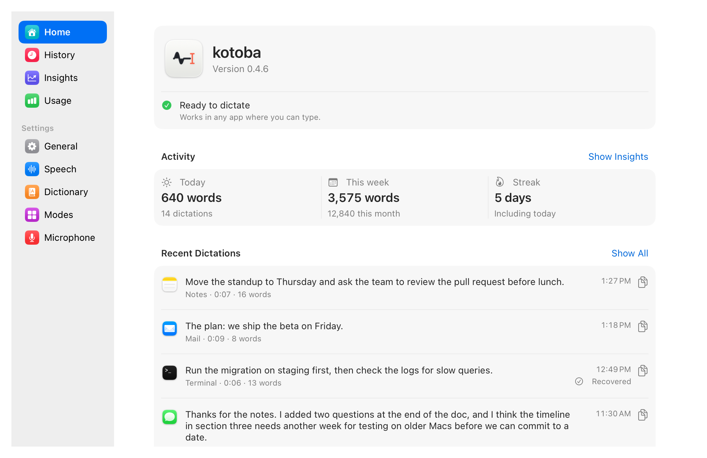
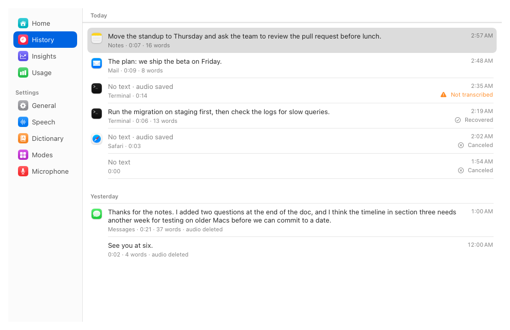
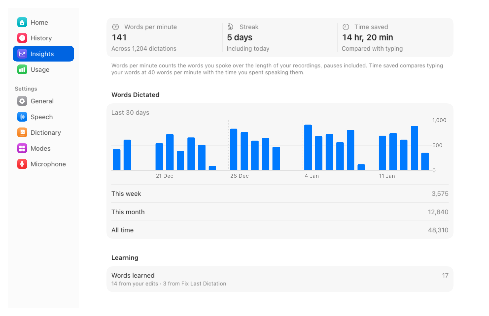
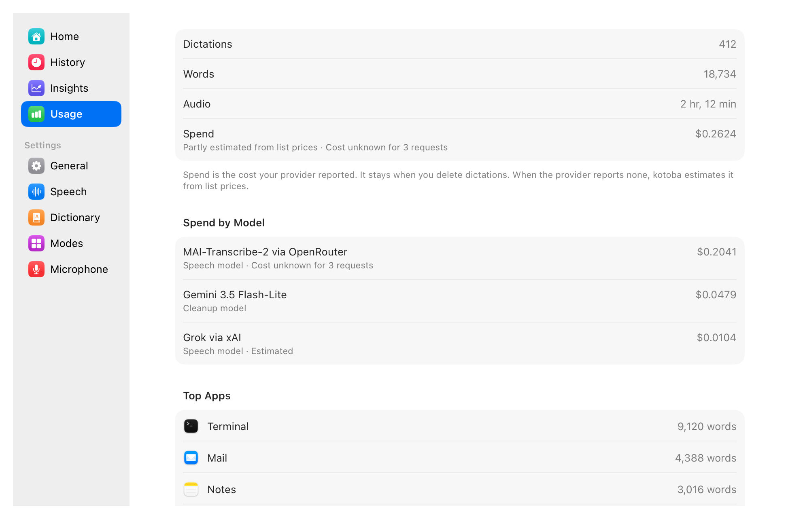
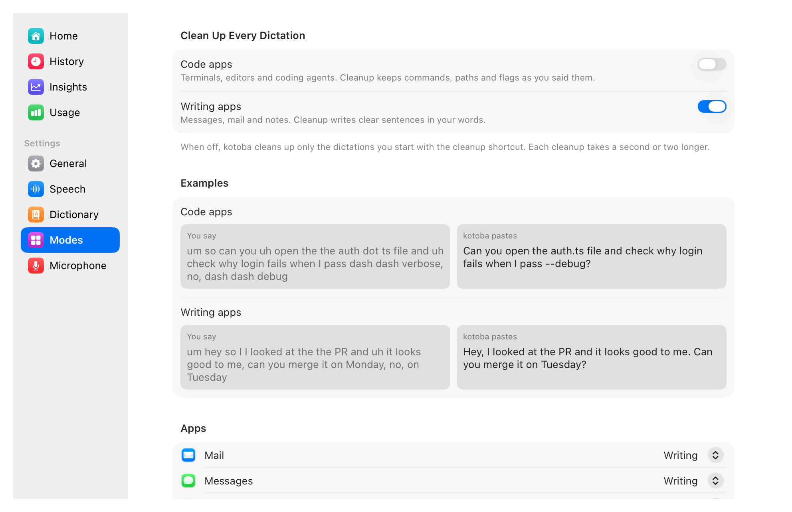
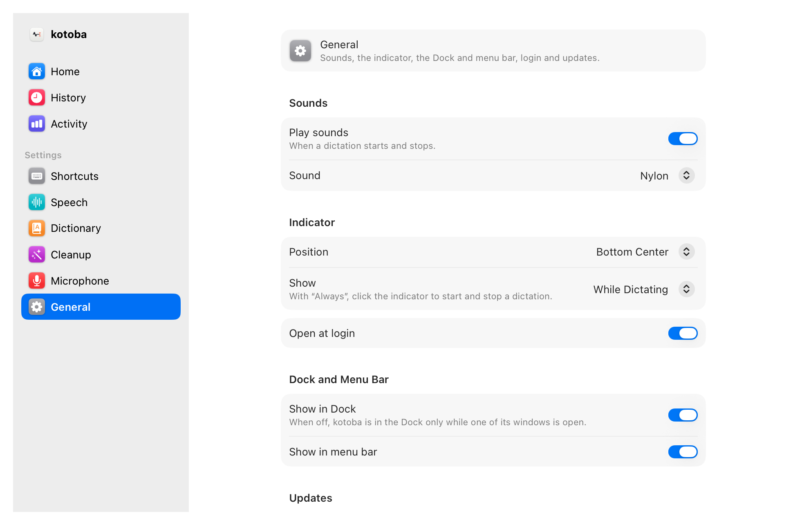

<p align="center">
  <picture>
    <source media="(prefers-color-scheme: dark)" srcset="design/icon/source/app-icon-dark.svg">
    
  </picture>
</p>

<h1 align="center">kotoba</h1>

<p align="center">
  <b>Dictation for macOS that gets your technical words right.</b><br>
  Tap a shortcut, speak, tap again. About one second later, your words are in the app you are using.
</p>

<p align="center">
  <a href="https://github.com/shiroyasha9/kotoba/releases/latest"><b>Download for macOS</b></a>
  · Free and open source · macOS 26 or later
</p>

<p align="center">
  <picture>
    <source media="(prefers-color-scheme: dark)" srcset="docs/images/readme-home-dark.png">
    
  </picture>
</p>

<p align="center">
  <picture>
    <source media="(prefers-color-scheme: dark)" srcset="docs/images/indicator-listening-dark.png">
    
  </picture>
  &nbsp;
  <picture>
    <source media="(prefers-color-scheme: dark)" srcset="docs/images/indicator-transcribing-dark.png">
    
  </picture>
</p>

kotoba is a native, open-source alternative to Wispr Flow, built for developers who dictate prompts for coding agents: text full of file names, flags and identifiers, typed into terminals, editors and browsers.

## Why kotoba

- Your words appear about one second after you stop.
- Add names and terms to your dictionary, and kotoba spells them your way. On 62 real dictations it got 84.6% of technical terms exactly right, against 50.0% for Wispr Flow.
- You need no account, kotoba has no server of its own, and it sends no telemetry. Your audio goes only to the speech service you choose, with your own key.
- There is no subscription. You pay OpenRouter about $0.10 per hour of audio, and kotoba uses 15.9 MB of memory at idle.

## kotoba vs Wispr Flow

| | kotoba | Wispr Flow |
|---|---|---|
| Technical terms transcribed exactly | **84.6%** (44 of 52) | 50.0% (26 of 52) |
| Word error rate on real dictations | **3.3%** | 6.0% |
| Memory at idle (no window open) | **15.9 MB** | 748 MB (third-party test) |
| Speech round trip, p50 / p90 | 902 ms / 1,083 ms | not compared |
| Price | **about $0.10 per hour of audio** | $12-15 per month for Pro |
| Download | 5.7 MB DMG | |

62 real dictations from one developer, mostly coding prompts. Methods, sources and limits: [docs/benchmarks.md](docs/benchmarks.md).

## Features

### Dictate anywhere

- Tap ⌃⌥⌘ to start and again to stop, or hold it while you speak. Any shortcut works, even fn alone, and push to talk can have its own, even ⌥ alone.
- Text goes into the focused app: terminals, editors, browsers, chat. Your clipboard comes back after the paste.
- Esc cancels, with 5 seconds to Undo. Press Return while you speak, or end with "press enter", to paste and send in one step.
- A small indicator shows the mic level and warns when the mic hears nothing.
- When AirPods play your music, kotoba records from the built-in mic, so your music does not drop to call quality.
- kotoba lives in the Dock and the menu bar, and you can hide either one.

### Get technical words right

- A personal dictionary goes to the speech model as hints, plus replacement rules that run on every transcript.
- kotoba learns from your edits: fix a word right after a paste, and kotoba adds it. For terminals, use "Fix Last Dictation…".
- Import your Wispr Flow dictionary in one click, with the corrections Wispr learned.

### Clean up, per app

- A second shortcut (⌃⌥⇧⌘) runs the transcript through an LLM that removes filler words and fixes punctuation: Gemini 3.5 Flash-Lite, Qwen 3.8 27B on Cerebras or Claude Haiku 5.5.
- Code mode keeps commands, paths and flags as you said them. Writing mode writes clear sentences in your words. kotoba picks the mode from the app in front.

### Never lose a dictation

- A failed dictation keeps its audio and retries when the network comes back. After a crash, kotoba transcribes the lost recording at the next launch.
- History keeps every dictation, with search, Copy, Paste Again and Retry.
- Paste your last dictation again from the menu or with its own shortcut.

### See what you dictate

- Insights: words per minute, your streak, time saved compared with typing, and your top apps.
- Usage: words, audio and spend per model, from the cost OpenRouter reports.

### Speech models

MAI-Transcribe-2 (recommended) or Grok through OpenRouter, with one key. Under Advanced, you can use Grok through xAI or MAI-Transcribe-2 through Azure with your own key.

## Screenshots

<table>
  <tr>
    <td width="50%">
      <picture>
        <source media="(prefers-color-scheme: dark)" srcset="docs/images/readme-history-dark.png">
        
      </picture>
      <p align="center">History</p>
    </td>
    <td width="50%">
      <picture>
        <source media="(prefers-color-scheme: dark)" srcset="docs/images/readme-insights-dark.png">
        
      </picture>
      <p align="center">Insights</p>
    </td>
  </tr>
  <tr>
    <td width="50%">
      <picture>
        <source media="(prefers-color-scheme: dark)" srcset="docs/images/readme-usage-dark.png">
        
      </picture>
      <p align="center">Usage</p>
    </td>
    <td width="50%">
      <picture>
        <source media="(prefers-color-scheme: dark)" srcset="docs/images/readme-modes-dark.png">
        
      </picture>
      <p align="center">Modes</p>
    </td>
  </tr>
  <tr>
    <td colspan="2" align="center">
      <picture>
        <source media="(prefers-color-scheme: dark)" srcset="docs/images/readme-general-dark.png">
        
      </picture>
      <p align="center">General</p>
    </td>
  </tr>
</table>

The screenshots show sample data.

## Install

1. Download the latest `kotoba-<version>.dmg` from [Releases](https://github.com/shiroyasha9/kotoba/releases). It is signed with a Developer ID and notarized by Apple.
2. Drag kotoba to Applications and open it.
3. Setup asks for the microphone, then Accessibility (so kotoba can hear the shortcut in every app and paste your text), then an [OpenRouter](https://openrouter.ai) key. If Wispr Flow is installed, it offers to import your dictionary.

kotoba updates itself with [Sparkle](https://sparkle-project.org).

## Privacy

- Audio goes only to the speech service you choose, with your own key. There is no kotoba server and no account.
- On OpenRouter, kotoba asks for endpoints that keep no data (`provider.zdr`) for MAI-Transcribe-2 and for every cleanup model. Grok has no such endpoint, and kotoba tells you when you pick it.
- API keys stay in the macOS Keychain. Transcripts, audio and your dictionary stay in `~/Library/Application Support/kotoba/`.
- kotoba sends no analytics and no crash reports. Its only other request is Sparkle's daily update check, which you can turn off.
- To learn from your edits, kotoba reads the field you pasted into for a short time after the paste. It never reads password fields, and it keeps only the words it learns.

## Limits

- English only for now.
- Cloud only: kotoba needs a network connection and a paid key. There are no local speech models.
- Not in the Mac App Store: its sandbox blocks the global shortcut and the paste.

## Build from source

You need Xcode 26 or later and [XcodeGen](https://github.com/yonaskolb/XcodeGen) (`brew install xcodegen`).

1. In `project.yml`, set `CODE_SIGN_IDENTITY` and `DEVELOPMENT_TEAM` to your own signing identity and team. The values in the repository belong to the maintainer and do not work on your Mac.
2. If you publish your own builds, also change `SUFeedURL` and `SUPublicEDKey` in `project.yml` (see `docs/release.md`).
3. Run:

   ```sh
   make gen     # generates Kotoba.xcodeproj from project.yml
   make build   # builds the app into build/DerivedData
   ```

`make build` makes "kotoba Dev", a separate install with its own settings, data and permissions, so it never touches your kotoba. `make check` runs the formatter, the linter, the build and the tests (it also needs `swiftlint`). Start with `AGENTS.md`, `CODING_STANDARDS.md` and `docs/spec.md`.

## Licence and credits

Apache License 2.0, see [LICENSE](LICENSE). Third-party code and its licences are listed in [NOTICE](NOTICE); today that is [Sparkle](https://github.com/sparkle-project/Sparkle) (MIT).

kotoba's design takes ideas from [Jot](https://github.com/google-gemini/jot-gemini-transcribe-macOS), [Hex](https://github.com/kitlangton/Hex) and [FreeFlow](https://github.com/zachlatta/freeflow).
