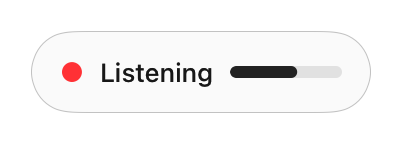
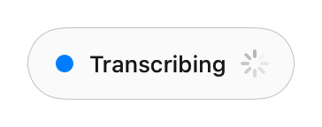
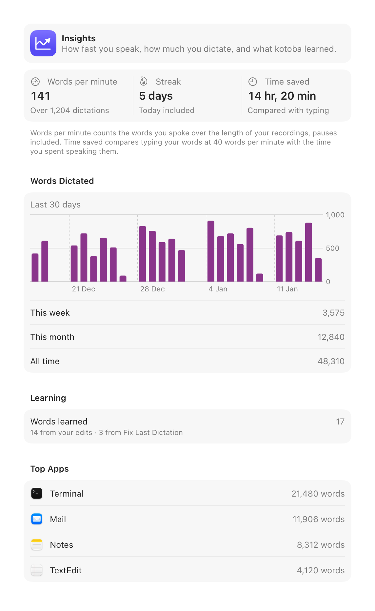
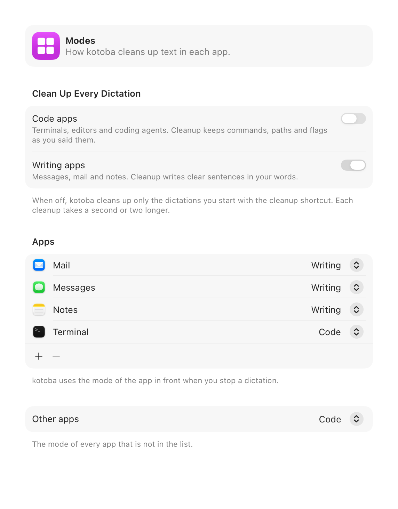
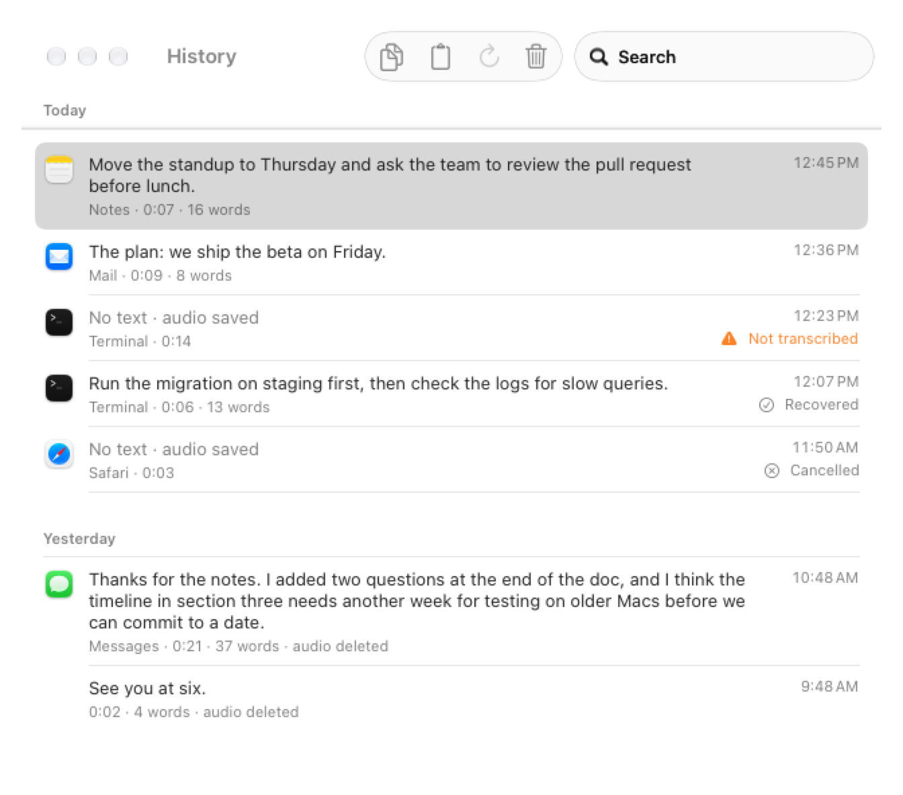
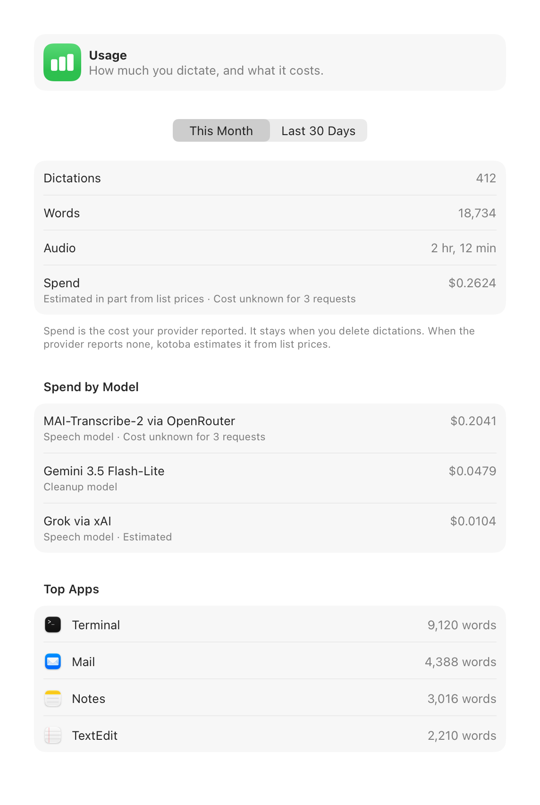

<p align="center">
  <picture>
    <source media="(prefers-color-scheme: dark)" srcset="design/icon/source/app-icon-dark.svg">
    
  </picture>
</p>

<h1 align="center">kotoba</h1>

<p align="center">
  Menu-bar dictation for macOS. Tap a shortcut, speak, tap again, and kotoba pastes your words into the app you are using.
</p>

<p align="center">
  <a href="https://github.com/shiroyasha9/kotoba/releases/latest">Download</a> ·
  <a href="#numbers">Numbers</a> ·
  <a href="#features">Features</a> ·
  <a href="#install">Install</a> ·
  <a href="#privacy">Privacy</a> ·
  <a href="#build-from-source">Build from source</a>
</p>

kotoba is a native, open-source alternative to Wispr Flow, built for developers who dictate prompts for coding agents: text full of file names, flags and identifiers, typed into terminals, editors and browsers. The microphone opens when you press the shortcut, the audio goes to a cloud speech model with your own OpenRouter key, and kotoba pastes the text where your cursor is. There is no account and no subscription: you pay OpenRouter about $0.10 per hour of audio.

<p align="center">
  <picture>
    <source media="(prefers-color-scheme: dark)" srcset="docs/images/indicator-listening-dark.png">
    
  </picture>
  &nbsp;
  <picture>
    <source media="(prefers-color-scheme: dark)" srcset="docs/images/indicator-transcribing-dark.png">
    
  </picture>
</p>

## Numbers

| | kotoba | Wispr Flow |
|---|---|---|
| Memory at idle | **15.9 MB** | 748 MB (third-party test) |
| Word error rate on real dictations | **3.3%** | 6.0% |
| Technical terms transcribed exactly | **84.6%** (44 of 52) | 50.0% (26 of 52) |
| Speech round trip, p50 / p90 | 902 ms / 1,083 ms | not compared |
| Price | **about $0.10 per hour of audio**, paid to OpenRouter | $12-15 per month for Pro |
| Download | 4.4 MB DMG | |

How these were measured:

- **Memory.** Release build with Sparkle, idle 35 s after launch, no window opened: physical footprint from `vmmap --summary`, median of 5 launches (range 15.6-16.8 MB), on an M3 Pro with macOS 27. This was measured on the 0.1.0 shape of the app; see [`docs/research/memory-spike.md`](docs/research/memory-spike.md). Opening Settings or History loads SwiftUI, which adds about 18-24 MB that stays until you quit. The Wispr Flow figure is not ours: it is from [tl;dv's review](https://tldv.io/blog/wispr-flow-notetaker-review/) (Wispr Flow 1.6.937 at rest on an 8 GB iMac), quoted in [`docs/research/beyond-wispr.md`](docs/research/beyond-wispr.md).
- **Accuracy.** 62 real dictations from one developer, mostly coding prompts in a terminal, each with a hand-corrected reference. kotoba ran MAI-Transcribe-2 through OpenRouter with the personal dictionary sent as a phrase list. The Wispr Flow column is Wispr's own speech recognition on the same clips (its raw transcript, before its formatter). The 95% confidence interval for kotoba's word error rate is 1.6-5.8%; 62 clips is a small set. Details in [`docs/research/quality-perf-2.md`](docs/research/quality-perf-2.md); the harness is in [`bench/`](bench/). The audio is personal, so the clips and the full report are not in this repository.
- **Round trip.** From the start of the upload to the full answer, for MAI-Transcribe-2 through OpenRouter with zero data retention on. 40 clips of 10-20 s, sent one at a time from a home network in India by the bench harness, not by the app. A second run without zero data retention gave p50 881 ms and p90 1,461 ms. The app's own target from stop tap to paste is p50 at most 1.0 s and p90 at most 1.5 s; `make latency` reports it from the app's latency log.
- **Price.** The speech requests of that bench cost $0.17 for 99.2 minutes of audio, which matches OpenRouter's list price of $0.10 per hour. MAI-Transcribe-2 is in public preview, and this price is a promotion until 2026-12-31. Cleanup, which is optional, costs extra. Wispr Flow's price is from its Pro plan ($15 per month, or $12 per month billed yearly), as quoted in `docs/research/beyond-wispr.md`.
- **Download.** The size of `kotoba-0.1.0.dmg` on the Releases page.

Two more numbers from the capture path (built-in mic, from the commit that moved capture to AUHAL): recording starts 38-47 ms after the key press, and after the stop tap kotoba waits at most 13 ms for the last audio, so your last word is kept.

## Features

**Dictate anywhere**

- Tap ⌃⌥⌘ to start and tap again to stop, or hold it while you speak. Pick your own shortcut in Settings, including a modifier-only one such as fn.
- Esc cancels. For 5 seconds, Undo resumes the same recording.
- Press Return while you dictate to stop, paste and press Return in one step. Or end with "press enter": kotoba pastes the text without the phrase, then presses Return.
- Text goes into the focused app (terminals, editors, browsers, chat), and your clipboard comes back after the paste. kotoba marks the paste as transient, so clipboard managers skip it.
- A small indicator shows what kotoba is doing and the mic level. It warns when the mic hears nothing, and when secure input is on. Show it only while you dictate or all the time (then a click starts and stops a dictation). Drag it to the bottom center or to the left or right edge.
- Choose your microphone and the order in which kotoba prefers them. When AirPods are your output, kotoba records from the built-in mic, so your music does not drop to call quality.

**Get technical words right**

- A personal dictionary for names and technical words, sent to the speech model as hints, plus replacement rules that run on every transcript. The model takes up to 100 words. When your list is longer, kotoba sends the words you star first, then the words you use most, and marks the words it did not send. Press ⌘F to search the list.
- One-click import of your Wispr Flow dictionary, including the corrections Wispr learned.
- Learns from your edits: when you fix a word right after a paste, kotoba adds it to your dictionary and shows it with Undo. Less certain fixes go to Suggestions. For apps it cannot read, such as terminals, use "Fix Last Dictation…" in the menu, or "Fix Dictation…" on any dictation in History. To add a word that kotoba got right, select it in that window and click "Add Selected Word".

**Cleanup and per-app modes**

- A second shortcut (⌃⌥⇧⌘ by default) sends the transcript through an LLM that removes filler words and fixes punctuation. Choose Gemini 3.5 Flash-Lite (default), Qwen 3.8 27B on Cerebras or Claude Haiku 5.5. Normal dictations skip this step.
- Two modes, Code and Writing. kotoba picks the mode from the app in front when you stop. Code (terminals, editors, coding agents) keeps commands, paths and flags as you said them. Writing (messages, mail, notes) writes clear sentences in your words. Each mode can clean up every dictation; both are off by default. Edit which app uses which mode.
- When a cleanup takes longer than 5 seconds, kotoba pastes the raw text and says so. "Paste Last Without Cleanup" in the menu gives you the raw text of a cleaned dictation.

**Never lose a dictation**

- A failed dictation keeps its audio and retries by itself when the network returns. Results land in "Recovered Dictations" in the menu.
- If kotoba stops during a recording (a crash or a force quit), it finds the audio at the next launch and transcribes it into "Recovered Dictations". Nothing is pasted.
- History: every dictation by day, with search, Copy, Paste Again, Retry and Delete.
- kotoba keeps audio for 1, 7 or 30 days or forever (7 by default for new installs); the text stays. Audio that was never transcribed is never deleted automatically.
- "Paste Last Dictation" and "Copy Last Dictation" in the menu. You can also set a shortcut for Paste Last Dictation in Settings > General. It has no default, so it never takes a shortcut from another app.

**See what you dictate**

- Insights: words per minute, your daily streak, time saved compared with typing at 40 words per minute, words per day, words learned and your top apps.
- Usage: dictations, words, audio length and spend per model, from the cost OpenRouter reports (or an estimate from list prices when it reports none).

**Speech models**

- MAI-Transcribe-2 through OpenRouter (recommended) or Grok through OpenRouter, with one OpenRouter key.
- Under Advanced: Grok through xAI and MAI-Transcribe-2 through Azure, with your own xAI or Azure key.

## Screenshots

The screenshots show sample data.

<table>
  <tr>
    <td width="50%">
      <picture>
        <source media="(prefers-color-scheme: dark)" srcset="docs/images/insights-dark.png">
        
      </picture>
      <p align="center">Insights</p>
    </td>
    <td width="50%">
      <picture>
        <source media="(prefers-color-scheme: dark)" srcset="docs/images/modes-dark.png">
        
      </picture>
      <p align="center">Modes</p>
    </td>
  </tr>
  <tr>
    <td width="50%">
      <picture>
        <source media="(prefers-color-scheme: dark)" srcset="docs/images/history-dark.png">
        
      </picture>
      <p align="center">History</p>
    </td>
    <td width="50%">
      <picture>
        <source media="(prefers-color-scheme: dark)" srcset="docs/images/usage-dark.png">
        
      </picture>
      <p align="center">Usage</p>
    </td>
  </tr>
</table>

## Install

Requires macOS 26 or later.

1. Download the latest `kotoba-<version>.dmg` from [Releases](https://github.com/shiroyasha9/kotoba/releases).
2. Open it and drag kotoba to Applications.
3. Open kotoba from Applications. It appears in the menu bar, not in the Dock.

The app is signed with a Developer ID and notarized by Apple.

## First run

A setup window walks you through three steps, then lets you try a dictation:

1. **Microphone.** Allow microphone access when macOS asks.
2. **Accessibility.** Turn on kotoba in System Settings > Privacy & Security > Accessibility. kotoba needs it to notice the shortcut in every app and to paste your text.
3. **OpenRouter key.** Create a key at [openrouter.ai](https://openrouter.ai) and paste it. You pay OpenRouter for the audio you send.

The last step has a switch to open kotoba at login, on by default. You can change it later in Settings > General.

## Updates

kotoba updates itself with [Sparkle](https://sparkle-project.org). It checks once a day; turn this off in Settings > General. You can also click "Check for Updates…" in the menu.

## Privacy

- **Your key, your provider.** Audio goes only to the speech service you choose, with your own key. There is no kotoba server and no account.
- **Zero data retention.** On OpenRouter, kotoba asks for endpoints that keep no data (`provider.zdr`) for MAI-Transcribe-2 and for every cleanup model. Grok has no such endpoint on OpenRouter, and kotoba says so when you pick it.
- **Keys in the Keychain.** kotoba stores API keys in the macOS Keychain, not in files.
- **No telemetry.** No analytics and no crash reporting. The only other network request is Sparkle's update check, which you can turn off.
- **Local history.** Transcripts, audio and the dictionary stay on your Mac in `~/Library/Application Support/kotoba/`, with the audio retention you choose.
- **Learning stays local.** To learn from your edits, kotoba reads the text field you pasted into, for a short time after the paste, through Accessibility. It never reads password fields, and it keeps only the words it learns, not the text it read.

## Limits

- English only for now.
- Cloud only: kotoba needs a network connection and a paid key. There are no local speech models.
- Distributed outside the Mac App Store, because the App Store sandbox blocks the global shortcut and the synthetic paste.

## Build from source

You need Xcode 26 or later and [XcodeGen](https://github.com/yonaskolb/XcodeGen) (`brew install xcodegen`).

1. In `project.yml`, set `CODE_SIGN_IDENTITY` and `DEVELOPMENT_TEAM` to your own signing identity and team. The values in the repository belong to the maintainer and do not work on your Mac.
2. If you publish your own builds, also change `SUFeedURL` and `SUPublicEDKey` in `project.yml` (see `docs/release.md`).
3. Run:

   ```sh
   make gen     # generates Kotoba.xcodeproj from project.yml
   make build   # builds the app into build/DerivedData
   ```

`make build` makes a development build named "kotoba Dev", with its own settings, data, Keychain item and permissions, so it does not touch an installed kotoba. `make check` runs the formatter, the linter, the build and the tests (it also needs `swiftlint`). `AGENTS.md` and `CODING_STANDARDS.md` describe how the code is organised, and `docs/spec.md` holds the design decisions.

## Licence and credits

Apache License 2.0, see [LICENSE](LICENSE). Third-party code and its licences are listed in [NOTICE](NOTICE); today that is [Sparkle](https://github.com/sparkle-project/Sparkle) (MIT).

kotoba's design takes ideas from [Jot](https://github.com/google-gemini/jot-gemini-transcribe-macOS), [Hex](https://github.com/kitlangton/Hex) and [FreeFlow](https://github.com/zachlatta/freeflow).
